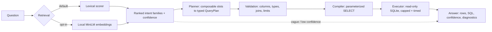

<div align="center">

# QueryScope

**Natural-language → SQL for business teams. No LLM API. No API bill. No data leaves the machine.**


</div>

---

## The business problem

Analysts spend a large share of their week answering recurring ad-hoc questions — *"what was revenue by country last quarter?"*, *"which products are underperforming?"* — by hand-writing SQL. Two options usually follow:

1. **Buy an LLM integration.** Fast to demo, but it introduces per-query API spend, data-governance exposure, nondeterministic SQL, and no structural guarantee that a generated statement is read-only.
2. **Do nothing.** Analysts keep spending minutes on every request, and business users wait.

QueryScope is a third option for a bounded, high-frequency domain: a **typed compiler** with a **local retrieval front-end** that turns common business questions into validated, parameterized SQL — with zero API fees and safety enforced by construction.

> This is a portfolio project built to demonstrate systems engineering for a solutions/consulting role. The warehouse is a deterministic Northwind-style dataset; the ROI model is an assumption-driven business-case artifact, not a measured client outcome.

---

## Impact at a glance

All numbers on the held-out test split of the benchmark are **generated by `scripts/run_eval.py`** — see [`docs/evaluation/RESULTS.md`](docs/evaluation/RESULTS.md).

| Dimension | Result |
|---|---:|
| Execution accuracy vs. independent gold SQL | **94.1%** |
| Overall decision accuracy (answer / clarify / refuse) | **94.4%** |
| Refusal precision across all categories | **100%** |
| False-refusal rate on in-scope questions | **0.0%** |
| Median latency (lexical, end-to-end) | **1.6 ms** |
| API cost per query | **$0.00** |
| Core runtime dependencies | **0** |

**Modelled business case** (defaults in `business/roi.py`, fully configurable):

| Assumption / output | Value |
|---|---:|
| Queries/day · working days/yr · adoption | 120 · 240 · 70% |
| Analyst minutes saved per query | 8 |
| Analyst hours returned per year | 2,688 |
| Annual labour value released | $228,480 |
| Annual QueryScope run cost | $0 |
| LLM baseline (1,200 tok @ $0.01/1k) | $241.92/yr |
| One-time build effort (80 h @ $85) | $6,800 |
| Payback | 7.1 working days |

The comparison is deliberate: the value here is **not** token savings. It is that a free, deterministic system can capture most of a bounded workload while removing governance and correctness risk.

---

## See it in 30 seconds

```bash
pip install -e .
python scripts/build_db.py
python -m queryscope demo
# open http://127.0.0.1:8765
```

Or from the terminal:

```bash
$ python -m queryscope ask "top 5 products by revenue" --explain

[OK] top 5 products by revenue
    intent: top_n    confidence: 1.000

    SQL:
      SELECT "products"."product_name" AS "dim_0",
             SUM(("order_items"."quantity" * "order_items"."unit_price"
                  * (1 - "order_items"."discount"))) AS "metric_1"
      FROM "order_items"
      JOIN "products" ON "order_items"."product_id" = "products"."product_id"
      GROUP BY "products"."product_name"
      ORDER BY "metric_1" DESC LIMIT ?
    params: (5,)

    dim_0                 | metric_1
    ----------------------+------------------
    Product Dairy 22      | 77658.34
    ...
    3.4 ms    est. scan cost: 210
```

Notice what is **not** there: no API call, no model inference, no string interpolation, and no possibility of a `DROP`.

---

## Architecture



Full layer contracts, safety invariants and extension points: [`docs/ARCHITECTURE.md`](docs/ARCHITECTURE.md).

### The core idea

**Retrieval is a thin front-end; the compiler is the backbone.**

Eight *composable intent families* (`lookup`, `aggregate`, `trend`, `top_n`, `comparison`, `distribution`, `join_lookup`, `out_of_scope`) each define a slot skeleton. The planner combines metric × dimension × filter × time × rank slots into a frozen `QueryPlan`. Validation is then a pure function over that plan, and compilation is a pure function from plan to SQL plus bound parameters.

This is what keeps the system out of the "thin wrapper around string matching" trap — and it is why the safety guarantees are structural rather than best-effort.

---

## Design decisions and trade-offs

| Decision | Alternative rejected | Why this way | Cost accepted |
|---|---|---|---|
| Typed plan AST → compiler | Generate SQL text directly | Makes validation, safety and testing possible as pure functions | More code; slower to write |
| Retrieval + compiler hybrid | Fine-tuned local seq2seq model | Stronger systems story, transparent, lower compute, no opaque failure mode | Lower open-domain accuracy |
| Composable intent families | One template per question | One skeleton serves many phrasings; coverage is explainable | Curated vocabulary to maintain |
| Lexical scoring **by default** | Embeddings by default | Zero downloads, 1.6 ms vs 13.8 ms, and *higher* accuracy on this benchmark (94.1% vs 88.2%) | Brittle to unseen synonyms |
| Semantic scorer opt-in and removable | Single hard-wired scorer | A/B measurable in one flag; swap without touching the compiler | Optional ~90 MB local model |
| Read-only `mode=ro` + bound params | Sanitize strings after generation | Impossible-to-write-by-construction beats regex blacklists | No write features at all |
| Fixed demo schema | Arbitrary user schemas | Depth over breadth; join graph and measures can be modelled properly | Not a generic product |
| Confidence tuned on calibration split, scored on held-out test | Tune and report on the same file | Prevents threshold leakage; numbers are defensible | Fewer test cases |
| Injectable clock (`EVAL_NOW`) | Real system time | Gold SQL for relative dates never drifts | Caller must pass `now` in tests |
| CLI + stdlib `http.server` demo | Flask / Streamlit | Zero dependency surface; runs anywhere Python runs | Less elaborate UI |
| `needs_clarification` as a first-class status | Always guess the closest intent | Avoids confidently wrong answers on vague questions | Some users must rephrase |

### What I would do next

1. Add a secondary "schema adapter" so the compiler can target a client's warehouse after introspection.
2. Add a cost-based join planner using real cardinalities instead of the current FK-graph BFS.
3. Replace the intent catalog with a locally trained classifier **only if** the measured 94% ceiling becomes the binding constraint.
4. Add a feedback loop that logs refusals as new candidate phrases for the lexicon.

---

## Evaluation

`python scripts/run_eval.py` regenerates both `docs/evaluation/RESULTS.md` and `results.json`. Nothing in the README is hand-typed.

- **64 questions** across 9 categories: simple, aggregate, trend, top_n, comparison, distribution, join_lookup, ambiguous, out_of_scope.
- **Deterministic 70/30 split** by hash of question id. Threshold tuned on calibration only; all headline numbers from the 18 held-out cases.
- **Execution accuracy** compares result sets to independently written gold SQL, order-insensitive, floats to 2 decimals.
- **Refusal precision** is measured across *every* category, so a wrongly refused in-scope question counts as a false positive.
- **Clock pinned to 2026-06-30** so `last quarter` always means 2026-01-01 → 2026-03-31.

### Retriever A/B — an honest result

| Retriever | Execution accuracy | Decision accuracy | Refusal precision | p50 latency |
|---|---:|---:|---:|---:|
| Lexical (default) | **94.1%** | **94.4%** | **100%** | **1.6 ms** |
| Semantic (opt-in, local) | 88.2% | 88.9% | 50% | 13.8 ms |

The simpler scorer wins on this benchmark. That is a finding, not an embarrassment: the semantic retriever's cosine scale makes the confidence threshold harder to calibrate, and it adds latency without improving accuracy at this domain size. It stays in the repo as a swappable reference implementation — the point is that the architecture lets you measure the choice instead of asserting it.

---

## Safety and governance

- Every identifier in emitted SQL comes from the introspected catalog.
- Every literal is a bound `?` parameter. `'; DROP TABLE orders; --` stays a string value in `params`, never SQL text.
- Connections open with `file:...?mode=ro` and `PRAGMA query_only=ON`; a mutating-keyword pre-check refuses write requests before retrieval.
- A progress handler aborts long-running queries; row output is capped; `LIMIT` is clamped to 1–1000.
- Low confidence, vague phrasing, and tied intents produce `refused` or `needs_clarification` instead of a guess.
- No telemetry, no network calls in the default path, no model download on install.

---

## Quickstart

```bash
# 1. install (core has no third-party dependencies)
pip install -e .

# 2. build the deterministic demo warehouse
python scripts/build_db.py

# 3. ask a question
python -m queryscope ask "total revenue by country" --explain
python -m queryscope ask "delete all orders" --json     # -> refused

# 4. optional: local semantic retrieval (no API, downloads a ~90 MB model once)
pip install -e ".[semantic]"
python -m queryscope ask "top 5 products by revenue" --semantic

# 5. verify everything
pip install -e ".[dev]"
python -m pytest -q
python scripts/run_eval.py
python business/roi.py --json
```

---

## Project structure

```
queryscope/
├── README.md                       # this document
├── docs/
│   ├── ARCHITECTURE.md             # layer contracts, safety invariants
│   ├── evaluation/RESULTS.md       # generated evaluation report
│   └── superpowers/                # design doc + implementation plan
├── src/queryscope/
│   ├── models.py                   # typed AST and answer vocabulary
│   ├── catalog.py                  # schema introspection + FK graph
│   ├── lexicon.py                  # business term -> canonical token
│   ├── intents.py                  # eight composable intent families
│   ├── retrieval.py                # lexical + optional semantic scorers
│   ├── planner.py                  # slot composition, ambiguity, time
│   ├── validation.py               # legality as structured diagnostics
│   ├── compiler.py                 # plan -> parameterized SQL
│   ├── executor.py                 # read-only, bounded execution
│   ├── engine.py                   # orchestration facade
│   ├── __main__.py                 # CLI
│   └── demo_server.py              # zero-dependency web UI
├── data/                           # seed.sql + generated SQLite file
├── benchmarks/questions.jsonl      # 64 labelled questions + gold SQL
├── business/roi.py                 # configurable adoption business case
├── scripts/                        # build_db.py, run_eval.py
├── tests/                          # 32 tests
└── .github/workflows/ci.yml
```

---

## Limitations — stated plainly

- One fixed schema and eight intent families. This is **not** a generic text-to-SQL product.
- Vocabulary coverage depends on a curated synonym table; unseen phrasing can be refused.
- Join order is a breadth-first walk of the FK graph, not a cost-based optimizer.
- "Estimated scan cost" is an `EXPLAIN QUERY PLAN` heuristic (100/SCAN, 10/SEARCH, 50/TEMP), not a timing.
- The held-out test split is 18 questions — enough to catch regressions, not enough for a tight confidence interval.
- The ROI numbers are an explicit model with editable assumptions, not observed savings.
- Relative-time semantics (`last quarter` = most recently completed quarter) are a product decision, not universal.

I would rather state these in the README than let an interviewer find them.

---

## What this demonstrates for a solutions role

| Consulting competency | Where it shows up |
|---|---|
| Structured problem framing | Bounded domain chosen deliberately; non-goals and anti-goals written down before code |
| Cost and value thinking | $0 architecture, explicit ROI model, honest LLM comparison |
| Systems design | Layered compiler pipeline, swappable retrieval, typed contracts between layers |
| Risk and governance | Read-only by construction, parameterization, bounded execution, structured refusal |
| Evidence-based decisions | Generated evaluation, calibration/test separation, retriever A/B with a negative result |
| Communication | This README, architecture doc, generated report, ADR-style trade-off table |
| Delivery | One-command setup, tests, CI, runnable CLI and demo |

**Interview question this project is built to answer:** *"When an LLM would be the obvious choice, can you design a cheaper, safer system that still delivers most of the value — and prove it with numbers?"*

---

## License

MIT — use it, change it, put it on a résumé.
