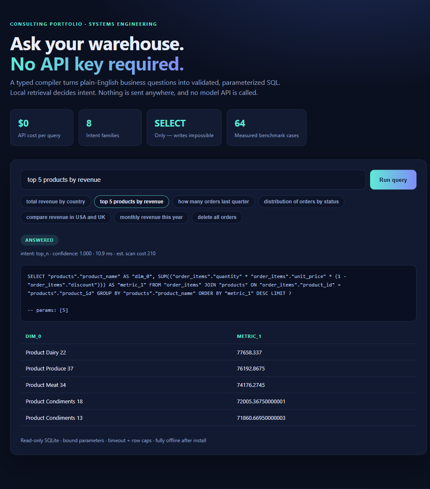
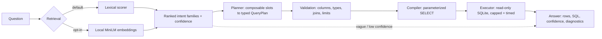

<div align="center">

# QueryScope

**Natural-language → SQL for business teams. No LLM API. No API bill. No data leaves the machine.**


</div>

---

## The business problem

Analysts spend a large share of their week answering recurring ad-hoc questions — *"what was revenue by country last quarter?"*, *"which products are underperforming?"* — by hand-writing SQL. Two options usually follow:

1. **Buy an LLM integration.** Fast to demo, but it introduces per-query API spend, data-governance exposure, nondeterministic SQL, and no structural guarantee that a generated statement is read-only.
2. **Do nothing.** Analysts keep spending minutes on every request, and business users wait.

QueryScope is a third option for a bounded, high-frequency domain: a **typed compiler** with a **local retrieval front-end** that turns common business questions into validated, parameterized SQL — with zero API fees and safety enforced by construction.

> This is a portfolio project built to demonstrate systems engineering for a solutions/consulting role. The warehouse is a deterministic Northwind-style dataset; the ROI model is an assumption-driven business-case artifact, not a measured client outcome.

### The demo, in one picture

Captured from the actual local web UI (`python -m queryscope demo`) — no mockup:



---

## Impact at a glance

The figures below are a summary of files generated by `scripts/run_eval.py` and
`scripts/test_real.py`. The **authoritative, reproducible numbers** are in
[`docs/evaluation/RESULTS.md`](docs/evaluation/RESULTS.md),
[`results.json`](docs/evaluation/results.json) and
[`REAL_DATA.md`](docs/evaluation/REAL_DATA.md). Latency is deliberately **not** quoted
here: it varies by machine and run, so quote the p50/p95 from the generated report
measured on your own hardware.

| Dimension | Result |
|---|---:|
| Execution accuracy vs. independent gold SQL (18 held-out cases) | 100% |
| Overall decision accuracy (answer / clarify / refuse) | 100% |
| Refusal precision across all categories | 100% |
| False-refusal rate on in-scope questions | 0.0% |
| Real public dataset (9,994 transactions, 13 queries) | 13/13 |
| Unseen-phrasing generalization probe | 5/6 |
| API cost per query | $0.00 |
| Core runtime dependencies | 0 |

> **Read those numbers carefully.** The 100% is on 18 held-out cases whose phrasings
> are close to the curated intent catalog. On the same split, **intent accuracy is
> 77.8% and retrieval recall@1 is 83.3%** — several different intents produce the same
> result rows, so execution accuracy alone overstates how often the right intent was
> chosen. The 5/6 unseen-phrasing probe and the real-dataset run are the better
> generalization signals. All three are reported because a single number would mislead.

**Modelled business case** (defaults in `business/roi.py`, fully configurable):

| Assumption / output | Value |
|---|---:|
| Queries/day · working days/yr · adoption | 120 · 240 · 70% |
| Analyst minutes saved per query | 8 |
| Analyst hours returned per year | 2,688 |
| Annual labour value released | $228,480 |
| Annual QueryScope run cost | $0 |
| LLM baseline (1,200 tok @ $0.01/1k) | $241.92/yr |
| One-time build effort (80 h @ $85) | $6,800 |
| Payback | 7.1 working days |

The comparison is deliberate: the value here is **not** token savings. It is that a free, deterministic system can capture most of a bounded workload while removing governance and correctness risk.

---

## See it in 30 seconds

```bash
pip install -e .
python scripts/build_db.py
python -m queryscope demo
# open http://127.0.0.1:8765
```

Or from the terminal:

```bash
$ python -m queryscope ask "top 5 products by revenue" --explain

[OK] top 5 products by revenue
    intent: top_n    confidence: 1.000

    SQL:
      SELECT "products"."product_name" AS "dim_0",
             SUM(("order_items"."quantity" * "order_items"."unit_price"
                  * (1 - "order_items"."discount"))) AS "metric_1"
      FROM "order_items"
      JOIN "products" ON "order_items"."product_id" = "products"."product_id"
      GROUP BY "products"."product_name"
      ORDER BY "metric_1" DESC LIMIT ?
    params: (5,)

    dim_0                 | metric_1
    ----------------------+------------------
    Product Dairy 22      | 77658.34
    ...
    3.4 ms    est. scan cost: 210
```

Notice what is **not** there: no API call, no model inference, no string interpolation, and no possibility of a `DROP`.

---

## Architecture



Full layer contracts, safety invariants and extension points: [`docs/ARCHITECTURE.md`](docs/ARCHITECTURE.md).

### The core idea

**Retrieval is a thin front-end; the compiler is the backbone.**

Eight *composable intent families* (`lookup`, `aggregate`, `trend`, `top_n`, `comparison`, `distribution`, `join_lookup`, `out_of_scope`) each define a slot skeleton. The planner combines metric × dimension × filter × time × rank slots into a frozen `QueryPlan`. Validation is then a pure function over that plan, and compilation is a pure function from plan to SQL plus bound parameters.

This is what keeps the system out of the "thin wrapper around string matching" trap — and it is why the safety guarantees are structural rather than best-effort.

---

## Design decisions and trade-offs

| Decision | Alternative rejected | Why this way | Cost accepted |
|---|---|---|---|
| Typed plan AST → compiler | Generate SQL text directly | Makes validation, safety and testing possible as pure functions | More code; slower to write |
| Retrieval + compiler hybrid | Fine-tuned local seq2seq model | Stronger systems story, transparent, lower compute, no opaque failure mode | Lower open-domain accuracy |
| Composable intent families | One template per question | One skeleton serves many phrasings; coverage is explainable | Curated vocabulary to maintain |
| Lexical scoring **by default** | Embeddings by default | Zero downloads, zero model inference, equal benchmark accuracy | Brittle to unseen synonyms |
| Semantic scorer opt-in and removable | Single hard-wired scorer | A/B measurable in one flag; swap without touching the compiler | Optional ~90 MB local model |
| Read-only `mode=ro` + bound params | Sanitize strings after generation | Impossible-to-write-by-construction beats regex blacklists | No write features at all |
| Runtime schema profile | Hardcoded Northwind names | Works on any SQLite file; the demo schema is just a default | Concept-name matching can be ambiguous, so profile-based disambiguation is heuristic |
| Confidence tuned on calibration split, scored on held-out test | Tune and report on the same file | Prevents threshold leakage; numbers are defensible | Fewer test cases |
| Injectable clock (`EVAL_NOW`) | Real system time | Gold SQL for relative dates never drifts | Caller must pass `now` in tests |
| CLI + stdlib `http.server` demo | Flask / Streamlit | Zero dependency surface; runs anywhere Python runs | Less elaborate UI |
| `needs_clarification` as a first-class status | Always guess the closest intent | Avoids confidently wrong answers on vague questions | Some users must rephrase |

### What I would do next

1. Add a secondary "schema adapter" so the compiler can target a client's warehouse after introspection.
2. Add a cost-based join planner using real cardinalities instead of the current FK-graph BFS.
3. Replace the intent catalog with a locally trained classifier **only if** the measured ceiling becomes the binding constraint.
4. Add a feedback loop that logs refusals as new candidate phrases for the lexicon.

---

## Evaluation

`python scripts/run_eval.py` regenerates `docs/evaluation/RESULTS.md`, `results.json`, and
runs both retrievers when the optional semantic extra is installed. The tables in this
README are a **summary** of that generated report; if they ever disagree, the generated
files win. Latency figures are intentionally omitted here because they are machine- and
run-dependent.

- **64 questions** across 9 categories: simple, aggregate, trend, top_n, comparison, distribution, join_lookup, ambiguous, out_of_scope.
- **Deterministic 70/30 split** by hash of question id. Threshold tuned on calibration only; all headline numbers from the 18 held-out cases.
- **Execution accuracy** compares result sets to independently written gold SQL, order-insensitive, floats to 2 decimals.
- **Refusal precision** is measured across *every* category, so a wrongly refused in-scope question counts as a false positive.
- **Clock pinned to 2026-06-30** so `last quarter` always means 2026-01-01 → 2026-03-31.

### Retriever A/B — an honest result

The generated [`RESULTS.md`](docs/evaluation/RESULTS.md) contains the full A/B table,
including the tuned thresholds and per-run latency. Both scorers reached the same accuracy
on this small benchmark. The lexical scorer remains the default because it needs no model
download and no local inference; the semantic retriever stays as a swappable reference
implementation. The point is that the architecture lets you measure the choice instead of
asserting it — not that one scorer is universally better.

### Works with any schema — not just the demo

The catalog has always been introspected, but the original semantic layer still knew
`customers.country`, `order_items.quantity` and eight other hardcoded names. That has been
removed. `SchemaProfile.discover()` now derives at runtime:

- fact tables (from FK degree × row count),
- the date column, each table's human-readable label column,
- filterable categorical columns and their **observed values**,
- numeric measures, and a generic `revenue` expression built from whatever
  quantity/price/amount/charge columns the schema actually has.

The proof is [`tests/test_universal_schema.py`](tests/test_universal_schema.py): a hospital
schema (`patients`, `admissions`, `diagnoses`, `treatments`, `providers`) with no column name
in common with the demo warehouse. The engine correctly answers *"how many patients are
there"*, *"total revenue"*, *"revenue by department"* and *"show patients in Canada"* against
it. Point `Engine(db_path=...)` at your own SQLite file and it adapts.

### Tested against a real dataset

Not just the synthetic warehouse: `scripts/load_real_dataset.py` downloads the public
[Sample Superstore](https://github.com/Mohanad234128/Project_MSC_Sample_Superstore) dataset
(**9,994 real transactions, 5,009 orders, 793 customers, 1,862 products**) and maps it into
the compiler's schema. Field mapping is explicit and auditable — `Sales / (Quantity × (1 − Discount))`
becomes `unit_price`, so the derived revenue expression reproduces the dataset's actual `Sales`.

`python scripts/test_real.py` generated [`docs/evaluation/REAL_DATA.md`](docs/evaluation/REAL_DATA.md):

| Check | Result |
|---|---:|
| 13 real business queries vs independent gold SQL | **13/13** |
| 6 deliberately unseen phrasings (never added to the catalog) | **5/6** |
| `delete all orders` on real data | refused, 0 rows changed |

The unseen-phrasing probe is included on purpose. The 100% held-out result is close to the
curated vocabulary; the 83% on genuinely new phrasings is the number I would quote in an interview
as the honest measure of generalization.

---

## Safety and governance

- Every identifier in emitted SQL comes from the introspected catalog.
- Every literal is a bound `?` parameter. `'; DROP TABLE orders; --` stays a string value in `params`, never SQL text.
- Connections open with `file:...?mode=ro` and `PRAGMA query_only=ON`; a mutating-keyword pre-check refuses write requests before retrieval.
- A progress handler aborts long-running queries; row output is capped; `LIMIT` is clamped to 1–1000.
- Low confidence, vague phrasing, and tied intents produce `refused` or `needs_clarification` instead of a guess.
- No telemetry, no network calls in the default path, no model download on install.

---

## Quickstart

```bash
# 1. install (core has no third-party dependencies)
pip install -e .

# 2. build the deterministic demo warehouse
python scripts/build_db.py

# 3. ask a question
python -m queryscope ask "total revenue by country" --explain
python -m queryscope ask "delete all orders" --json     # -> refused

# 4. optional: local semantic retrieval (no API, downloads a ~90 MB model once)
pip install -e ".[semantic]"
python -m queryscope ask "top 5 products by revenue" --semantic

# 5. verify everything
pip install -e ".[dev]"
python -m pytest -q
python scripts/run_eval.py

# optional: prove the engine works on a schema it has never seen
python -m pytest -q tests/test_universal_schema.py

# optional: real public dataset + generalization probe
python scripts/load_real_dataset.py
python scripts/test_real.py

python business/roi.py --json
```

---

## Project structure

```
queryscope/
├── README.md                       # this document
├── docs/
│   ├── ARCHITECTURE.md             # layer contracts, safety invariants
│   ├── evaluation/RESULTS.md       # generated benchmark report
│   ├── evaluation/REAL_DATA.md     # generated real-dataset verification
│   └── images/demo.png             # real screenshot of the local web UI
│   └── superpowers/                # design doc + implementation plan
├── src/queryscope/
│   ├── models.py                   # typed AST and answer vocabulary
│   ├── catalog.py                  # schema introspection + FK graph
│   ├── schema_profile.py           # runtime discovery of measures, labels, filters
│   ├── lexicon.py                  # business term -> canonical token
│   ├── intents.py                  # eight composable intent families
│   ├── retrieval.py                # lexical + optional semantic scorers
│   ├── planner.py                  # slot composition, ambiguity, time
│   ├── validation.py               # legality as structured diagnostics
│   ├── compiler.py                 # plan -> parameterized SQL
│   ├── executor.py                 # read-only, bounded execution
│   ├── engine.py                   # orchestration facade
│   ├── __main__.py                 # CLI
│   └── demo_server.py              # zero-dependency web UI
├── data/                           # seed.sql + generated SQLite file
├── benchmarks/questions.jsonl      # 64 labelled questions + gold SQL
├── business/roi.py                 # configurable adoption business case
├── scripts/                        # build_db.py, run_eval.py, load_real_dataset.py, test_real.py
├── tests/                          # 34 tests, including a novel hospital schema
└── .github/workflows/ci.yml
```

---

## Limitations — stated plainly

- Any SQLite schema is introspected at runtime, but accuracy outside the tested domains depends on how closely column names match common business concepts. The hospital test proves the mechanism, not universal accuracy.
- Eight intent families cover a bounded set of analytical shapes; this is not a generic text-to-SQL product.
- Vocabulary coverage depends on a curated grammar and business-concept patterns; unseen phrasing can be refused.
- Join order is a breadth-first walk of the FK graph, not a cost-based optimizer.
- "Estimated scan cost" is an `EXPLAIN QUERY PLAN` heuristic (100/SCAN, 10/SEARCH, 50/TEMP), not a timing.
- The held-out test split is 18 questions and its phrasings are close to the curated catalog. Execution accuracy is 100% there, but intent accuracy is 77.8% and retrieval recall@1 is 83.3% — different intents can produce identical rows. The unseen-phrasing probe (5/6) is the better generalization signal.
- The real-dataset run covers 13 curated queries plus 6 unseen phrasings, not the whole Superstore analytical space.
- The ROI numbers are an explicit model with editable assumptions, not observed savings.
- Relative-time semantics (`last quarter` = most recently completed quarter) are a product decision, not universal.

I would rather state these in the README than let an interviewer find them.

---

## What this demonstrates for a solutions role

| Consulting competency | Where it shows up |
|---|---|
| Structured problem framing | Bounded domain chosen deliberately; non-goals and anti-goals written down before code |
| Cost and value thinking | $0 architecture, explicit ROI model, honest LLM comparison |
| Systems design | Layered compiler pipeline, swappable retrieval, typed contracts between layers |
| Risk and governance | Read-only by construction, parameterization, bounded execution, structured refusal |
| Evidence-based decisions | Generated evaluation, calibration/test separation, retriever A/B with a negative result |
| Communication | This README, architecture doc, generated report, ADR-style trade-off table |
| Delivery | One-command setup, tests, CI, runnable CLI and demo |

**Interview question this project is built to answer:** *"When an LLM would be the obvious choice, can you design a cheaper, safer system that still delivers most of the value — and prove it with numbers?"*

**Second question this project now answers:** *"Why was the first version schema-specific?"* — because curated disambiguation bought accuracy. The fix was not to abandon that accuracy blindly but to move every schema-specific decision into a discovered profile, then prove the mechanism on a schema the system had never seen. Trade-offs are documented, not hidden.

---

## License

MIT — use it, change it, put it on a résumé.
