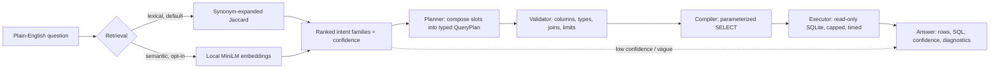

# Architecture

## The shape of the system

QueryScope is a **compiler with a retrieval front-end**. Retrieval decides *what kind* of question was asked; everything after that is deterministic, typed, and testable. The compiler is the product — retrieval is a swappable input to it.

## Layers

| Layer | File | Responsibility | Never does |
|---|---|---|---|
| Catalog | `catalog.py` | Introspect tables, columns, types, PK/FK graph, row counts | Hardcode schema knowledge |
| Schema profile | `schema_profile.py` | Derive fact tables, time column, label dimensions, categorical values, numeric measures and revenue expression from the catalog + data | Assume a table or column name |
| Lexicon | `lexicon.py` | Map business words to canonical tokens using the discovered profile | Emit SQL or name a schema object |
| Intents | `intents.py` | Define eight composable intent families with example phrasings | Bind to one question each |
| Retrieval | `retrieval.py` | Rank families and normalize scores to `[0,1]` | Decide the final query |
| Planner | `planner.py` | Compose metrics, dimensions, filters, time, rank into a `QueryPlan` | Write SQL text |
| Validation | `validation.py` | Reject illegal plans with structured diagnostics | Execute anything |
| Compiler | `compiler.py` | Render a validated plan to SQL with bound parameters | Accept raw user strings |
| Executor | `executor.py` | Read-only, timeout-, row- and cost-limited execution | Mutate data |
| Engine | `engine.py` | Orchestrate the pipeline and map failures to answer statuses | Hide failures |

## Schema universality

There are no table or column names in the planner, compiler, validator or lexicon.
`SchemaProfile.discover(catalog, connection)` derives everything domain-specific:

- **Fact tables** — ranked by `(outbound FK count + 1) × log(rows)`.
- **Time column** — DATE affinity or date-like tokens, preferring a fact table.
- **Label dimension** — a name-like, non-key TEXT column per table.
- **Filter values** — observed distinct values of low-cardinality TEXT columns (≤ 40).
- **Measures** — numeric non-key columns, plus a generic `revenue` expression built from
  a discovered amount/charge/sales column, or from `quantity × price × (1 − discount)`.

`tests/test_universal_schema.py` proves this with a hospital schema sharing no names with
the demo warehouse; the engine answers counts, revenue, grouping and filtering queries
against it without configuration.

## Safety invariants

1. **Identifiers come from the catalog only.** Every table and column name in emitted SQL was read from `PRAGMA table_info`, never from the question.
2. **Every literal is bound.** The compiler appends `?` placeholders and returns a separate params tuple. There is no string-interpolation path for values.
3. **Write access is structurally impossible.** Connections use `file:...?mode=ro` plus `PRAGMA query_only=ON`; a mutating-keyword pre-check refuses write requests before retrieval.
4. **Resources are bounded.** A progress handler aborts long queries, a row cap is always applied, and `LIMIT` is clamped to 1–1000.
5. **Uncertainty is surfaced.** Low confidence, vague phrasing, and score ties become `refused` or `needs_clarification` rather than a guessed query.

## Why the plan is a typed AST

Direct text generation makes validation impossible. A `QueryPlan` makes legality a pure function:

- `SUM` on a TEXT column → `BAD_AGGREGATION`
- a dimension set with no FK path → `NO_JOIN_PATH`
- an unresolvable date range → `BAD_RANGE`

Each failure is a value the caller can inspect, not an exception from SQLite. This is the main engineering decision in the project.

## Retrieval contract

Both scorers implement `retrieve(question, k) -> tuple[IntentMatch, ...]` and return a normalized score in `[0,1]`:

- **Lexical** (default): synonym-expanded Jaccard overlap. Zero dependencies, zero downloads.
- **Semantic** (opt-in): local `all-MiniLM-L6-v2` cosine, mapped by `(cos + 1) / 2`.

Thresholds are per-scorer because the scales differ. The evaluation harness tunes each on a calibration split only and reports on a held-out test split.

## Extension points

| Change | Where |
|---|---|
| New business vocabulary | `lexicon.py` synonym table |
| New question shape | `intents.py` family + `planner.py` composer |
| New derived measure | `compiler.py` `DERIVED_SQL` + `validation.py` |
| New schema | point `Engine(db_path=...)` at any SQLite file; catalog and profile adapt automatically |
| New scorer | implement the `Retriever` protocol |

## Known limits

Eight intent families, no discourse context, no joins chosen by a cost optimizer, and a heuristic scan-cost estimate rather than real query plans. Schema discovery is generic, but accuracy on an unseen schema depends on column names matching common business concepts. These are deliberate scope choices, documented in the README trade-off table.
